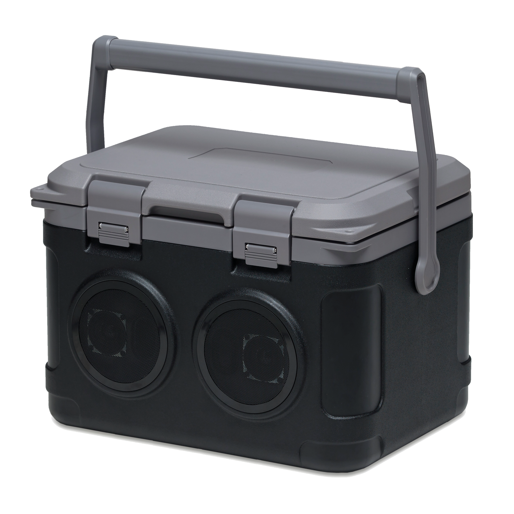

# SoundBox

A local sound library browser. Fuzzy search, waveform display, click-to-audition,
tagging and renaming.

Never modifies audio content. Renaming a file on disk is the only change it makes
to your library, and only when you ask for it. Tags, favourites and analysis live
in SoundBox's own database.

## Features

- Fuzzy search across your whole library, per keystroke
- Waveform view with zoom; click anywhere to play from there
- Folder tree per library root, click to filter
- Loudness (EBU R128) and peak dB per file, with optional preview normalisation to -18 LUFS
- "Find similar" based on audio features
- Tags and favourites, exportable and importable as `.sbpack` files to share with others
- Drag sounds straight out of the list into other apps
- Safe rename with undo
- Multiple library roots, grouped into profiles
- Rescan a folder to pick up new or changed files
- Remappable keyboard shortcuts (`Ctrl+/` to view them)
- Built-in updater

Formats: wav, flac, mp3, ogg (Vorbis), m4a/aac/alac, and the audio track of mp4/mov.

## Install

Grab the latest installer from the [Releases](https://github.com/Sirsyorrz/SoundBox/releases)
page. Windows and Linux builds are provided. Installed copies offer new versions
automatically.

- Windows: the `-setup.exe`. It's unsigned, so SmartScreen warns: "More info" then "Run anyway".
- Linux: the `.AppImage`, `chmod +x`, run.

## Build from source

Requires Node 20+ and a Rust toolchain, plus the
[Tauri v2 prerequisites](https://v2.tauri.app/start/prerequisites/) for your OS.

```bash
npm install
npm run tauri dev      # development
npm run tauri build    # installers in src-tauri/target/release/bundle
```

`./run.sh` builds and runs a release binary directly, without packaging.

There's also a CLI (`soundbox-cli`) sharing the app's active profile, with
`scan`, `probe`, `stats`, `play`, `search`, `similar`, `pack-export` and
`pack-import` commands:

```bash
cd src-tauri
cargo run --bin soundbox-cli -- search kick
```

## Stack

Tauri v2 + React/TypeScript on the front, Rust on the back: `symphonia` for
decoding, `cpal` for playback, `nucleo-matcher` for search, `ebur128` for loudness,
`rustfft` for similarity features, `rusqlite` for metadata.
